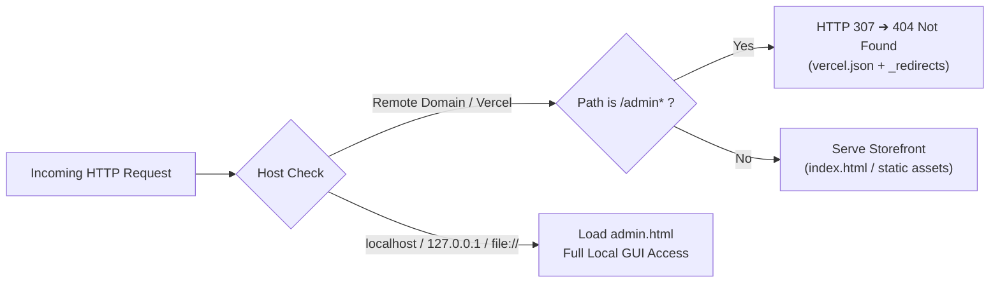

# Architecture & Dependency Graph – The Accessory Dock

This document provides a visual and structural blueprint of **The Accessory Dock** static deployment (`https://the-accessory-dock.vercel.app`). Use this reference to instantly understand data flow, component hierarchy, security rules, and file mappings without re-scanning the entire codebase.

---

## 1. System Architecture Diagram

```mermaid
flowchart TD
    subgraph Clients["Clients & Entrypoints"]
        PublicUser["📱 Public Shopper (Mobile / Desktop)"]
        StoreAdmin["🔒 Store Owner (Local Machine Only)"]
    end

    subgraph SecurityRouting["Edge Routing & Security Boundary (Vercel CDN)"]
        CDN["Vercel Edge Network"]
        VercelJSON["vercel.json<br/>(Clean static config & /admin redirect)"]
        HeadersConfig["_headers<br/>(Strict CSP, HSTS, No-Index on Admin)"]
        RedirectsConfig["_redirects<br/>(/admin* ➔ 404, /* ➔ index.html)"]
    end

    subgraph PublicStorefront["Public Storefront Layer"]
        IndexHTML["index.html<br/>(Semantic HTML5 Mobile-First Shell)"]
        StylesCSS["styles.css<br/>(Mobile-First CSS, 2-Col Grid, Bottom Sheets)"]
        ScriptJS["script.js<br/>(Catalog Render, Cart State, Search, Modal)"]
    end

    subgraph StorefrontComponents["Storefront Components & UI Modules"]
        HeaderMod["Header Component<br/>• Circular Emblem Logo<br/>• Brand Title<br/>• Cart Pill with Live Count<br/>• Full-Width Search Input"]
        HeroMod["Hero Component<br/>• Value Proposition<br/>• Trust Chips (Genuine, Fast, Support)"]
        CategoryNav["Category Nav (#categories)<br/>• Horizontal Snap-Scroll Pills<br/>• Dynamic Filter By Category"]
        ProductGrid["Product Grid (#products)<br/>• Mobile 2-Column Cards<br/>• Aspect-Ratio 1:1 Images<br/>• Discount & Stock Badges<br/>• Add to Cart & Buy Now Buttons"]
        DetailModal["Product Modal (#product-modal)<br/>• Mobile Bottom-Sheet Slide Up<br/>• Deduplicated Thumbnail Carousel<br/>• Direct WhatsApp Order Action"]
        CartDrawer["Cart Drawer (#cart-drawer)<br/>• Slide-in Panel with Close '✕'<br/>• Quantity +/- Controls & Delete<br/>• Total Price Summary<br/>• WhatsApp Order Handoff"]
        ThemeToggle["Dark Mode Toggle<br/>• Sleek Floating 🌙 Pill"]
    end

    subgraph LocalAdmin["Local-Only Admin Engine"]
        AdminHTML["admin.html<br/>(Protected by Client-Side & Edge Hostname Guard)"]
        AdminForm["Product CRUD Form<br/>• Auto Discount Computation<br/>• Code Uniqueness Validator"]
        AdminTable["Interactive Product Table<br/>• Live Search & Filter<br/>• One-Click Stock Toggle<br/>• Edit & Delete Handlers"]
        AdminExporter["JSON Exporter & Importer<br/>• One-Click 'Download products.json'<br/>• 'Copy JSON' to Clipboard<br/>• 'Import products.json' Preview"]
    end

    subgraph DataStorage["Data & Asset Layer"]
        ProductsJSON["products.json<br/>(Central Product Catalog)"]
        ImagesFolder["images/<br/>• logo.png (Circular 575x575)<br/>• Product Photography (JPG)"]
        BrowserStorage["Browser localStorage<br/>• cart: Saved Shopper Items<br/>• admin_products_cache: Working Draft"]
    end

    subgraph ExternalServices["External Endpoints"]
        WhatsAppAPI["WhatsApp API (wa.me/9779761806448)<br/>• Direct Product Inquiry<br/>• Formatted Cart Order Summary<br/>• 2.5s Rate Limiter & Debounce"]
        GoogleFonts["Google Fonts (Plus Jakarta Sans & Material Symbols)"]
    end

    %% Client Access Routes
    PublicUser -->|HTTPS| CDN
    StoreAdmin -->|Local file:// or localhost| AdminHTML

    %% Edge Routing
    CDN -->|GET /admin*| RedirectsConfig
    RedirectsConfig -->|307 / 404 Not Found| PublicUser
    CDN -->|GET /| HeadersConfig
    HeadersConfig --> IndexHTML

    %% Storefront Assembly
    IndexHTML --> StylesCSS
    IndexHTML --> ScriptJS
    IndexHTML --> HeaderMod
    IndexHTML --> HeroMod
    IndexHTML --> CategoryNav
    IndexHTML --> ProductGrid
    IndexHTML --> DetailModal
    IndexHTML --> CartDrawer
    IndexHTML --> ThemeToggle

    %% Storefront Data Binding
    ScriptJS -->|Fetch on Load| ProductsJSON
    ScriptJS -->|Read/Write Cart| BrowserStorage
    ProductGrid -->|Display Photos| ImagesFolder
    DetailModal -->|Display Gallery| ImagesFolder
    HeaderMod -->|Display Logo| ImagesFolder

    %% Admin Data Binding
    AdminHTML -->|Local Fetch / File Picker| ProductsJSON
    AdminHTML -->|Draft Backup| BrowserStorage
    AdminExporter -->|Export New Version| ProductsJSON

    %% External Handoffs
    DetailModal -->|Order Single Item| WhatsAppAPI
    CartDrawer -->|Checkout Full Cart| WhatsAppAPI
    IndexHTML -->|Web Fonts| GoogleFonts
```



---

## 2. File & Component Mapping Table

| File | Purpose | Key Responsibilities | Access Permission |
| :--- | :--- | :--- | :--- |
| [`index.html`](file:///c:/Users/khuku/Desktop/the-accessory-dock/index.html) | Storefront HTML | Semantic structure: Header, Hero, Category pills nav, 2-column product container, Bottom-sheet modal, Cart drawer, Footer. | Public Web (`/`) |
| [`styles.css`](file:///c:/Users/khuku/Desktop/the-accessory-dock/styles.css) | Mobile-First Styling | Mobile base rules (320px–639px), responsive breakpoints (640px, 1024px), CSS variables, dark mode theming, animations. | Public Web |
| [`script.js`](file:///c:/Users/khuku/Desktop/the-accessory-dock/script.js) | Storefront Logic | Fetches `products.json`, reactive rendering, cart state management, thumbnail switching, search filtering, WhatsApp message formatting. | Public Web |
| [`products.json`](file:///c:/Users/khuku/Desktop/the-accessory-dock/products.json) | Product Database | Static JSON array of product objects (Code, Name, Prices, Availability, Category, MainImage, Images, Description). | Public Web |
| [`images/`](file:///c:/Users/khuku/Desktop/the-accessory-dock/images/) | Image Assets | High-res product images and circular brand logo (`images/logo.png`). | Public Web |
| [`admin.html`](file:///c:/Users/khuku/Desktop/the-accessory-dock/admin.html) | Local Admin Portal | Visual product editor, one-click stock toggle, code validation, `products.json` file downloader/importer. | **LOCAL ONLY** (Blocked on Vercel) |
| [`vercel.json`](file:///c:/Users/khuku/Desktop/the-accessory-dock/vercel.json) | Vercel Deployment | Pure static configuration (`framework: null, outputDirectory: "."`), redirects `/admin(.*)` to `/404`. | Hosting Config |
| [`_headers`](file:///c:/Users/khuku/Desktop/the-accessory-dock/_headers) | Security Headers | Content Security Policy (`connect-src 'self'`), Strict HSTS, X-Frame-Options, X-Robots-Tag on admin. | Edge Server |
| [`_redirects`](file:///c:/Users/khuku/Desktop/the-accessory-dock/_redirects) | Routing Rules | Maps `/admin*` to `404`, wildcard fallback `/*` to `/index.html 200`. | Edge Server |

---

## 3. Key State Variables & Global Handlers (`script.js`)

```
script.js
│
├── State Variables:
│   ├── WA_NUMBER = "9779761806448"           (Store verified WhatsApp phone)
│   ├── products = []                         (In-memory catalog loaded from products.json)
│   ├── cart = []                             (Shopping cart loaded/persisted via localStorage)
│   └── activeCategory = ""                   (Current category filter: "" for All)
│
├── Core Pipeline:
│   ├── fetch("products.json") ──► renderCategories() ──► renderProducts() ──► updateCartUI()
│   ├── setCategory(cat) ────────► filterAndRender()
│   └── #search.input ───────────► filterAndRender()
│
├── Shopping Cart Actions:
│   ├── addToCart(code) ─────────► Updates qty ──► saveCart() ──► updateCartUI() ──► showToast()
│   ├── changeQty(i, delta) ─────► Updates or splices if 0 ──► saveCart() ──► updateCartUI()
│   ├── removeItem(i) ───────────► Splices item ──► saveCart() ──► updateCartUI()
│   └── checkoutWhatsApp() ──────► Formats itemized bill ──► window.open(wa.me link) ──► clears cart
│
└── Modal & Interactions:
    ├── openModal(code) ─────────► Renders bottom-sheet with deduplicated thumbnails
    ├── changeModalImage(src) ───► Switches active photo & adds .selected border to thumb
    ├── buyNow(code) ────────────► Formats direct single-product WhatsApp order
    └── floatingDarkToggle ──────► Toggles .dark-mode on document.body
```

---

## 4. Security & Isolation Matrix


